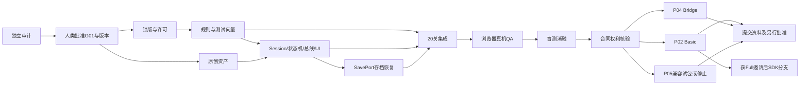

# G01 可执行任务DAG与交付闸门

全部未来开发任务为 **NOT_STARTED**；本轮只完成准备数据/文档/离线验证。`tasks.json` 是任务执行权威，每项包含role、前置、输入、输出、写入目录、DoD与验证方法。本章不能被理解为已经获准运行T03以后的任务。

## DAG



T12/13/14也直接依赖T09，避免合同审查替代技术QA。各分支某个渠道停止时必须提交有原因的停止报告而不是假通过，T15只覆盖正式决定继续的渠道；Full分支T16不阻断Basic可评审资料，但必须等正式Full邀请，当前没有邀请。

## 任务卡摘要

| ID | 独立任务与交接物 | 通过标准/责任 |
|---|---|---|
| T01 | 接收主控独立审计，逐项关闭整改 | 主控在根reviews/G01-audit.md管理独立Findings；作者仅在G01留修订/复验闭环，不代写代签独立审查 |
| T02 | 人类批准记录 | 指明G01、规格版本、已关闭阻断、可开发范围；没有则所有开发保持锁定 |
| T03 | 3.8.8工具锁/许可 | 可执行路径/版本/hash、编辑器条款、TS确切版、空项目命令行日志；不是游戏量产 |
| T04 | 纯规则TS与RuleFacts/UndoFacts | 20关每步一致；不含eventId/firstClear/stampCount、不发总线；同Attempt不同历史返回相同事实 |
| T05 | 06全资产生产与权属 | 所有源文件/导出/许可/hash齐，原始图声不同于参考表达；可并行T03/04 |
| T06 | SessionCoordinator/状态机/总线/SavePort/13屏 | Session唯一publisher及序号/进度写入者；同局面不同历史、胜利撤销再完成及中断向量；每接受rev一保存；UI按06 |
| T07 | 依赖T06 SavePort，本地双备份/恢复传输 | 27固定存档向量与未来断写/配额/新版冲突；不得改首通/rev或独发事件；结果返回Session |
| T08 | 依赖T04/T06/T07，Progress策略与20关/Session/保存集成 | 策略由Session唯一调用；首通/解锁/全通；胜利撤销再完成不重复章，每新rev一保存；固定数据hash无广告墙 |
| T09 | 本地测量报告 | 真实浏览器/真机、包体/加载/帧时间、后台/旋转/音频中断；未测项明确UNKNOWN |
| T10 | 真人盲测与独立变体比较 | 按12预注册、原始匿名数据及同意；不足样本不能宣称有效；可产出Revise/Kill |
| T11 | 各渠道权利矩阵 | 具体合同正文、独家/成本回收/IP边界/退出；缺关键正文停止该分支 |
| T12 | P02_BASIC专包 | 无SDK默认、无变现、无第三方回传、总≤20MB预算/1500文件硬门槛，符合PEGI-12非儿童内容 |
| T13 | P04 Bridge专包 | 无GA4/同类；Bridge、root index、拉丁命名、≤300MB、最低兼容与平台QA；不夹带P02 |
| T14 | P05可行性 | 指定SDK对Cocos书面支持、真Android试包或正式停止；拒绝将Web包称APK |
| T15 | 渠道分别可审资料 | 真实截图/视频、包hash、合同版本、授权清单、该渠道QA；待人类另批提交 |
| T16 | P02_FULL条件分支 | 正式邀请、Full SDK实际接入及QA，真实Gameplay start界定首包；本产品广告仍默认关 |

## 本轮可复验与未来命令

在G01目录运行：

```powershell
python tools/validate.py
python tools/write_level_catalog.py
python tools/check_audit_mutants.py
```

依赖在`tools/requirements-validation.txt`记录本轮jsonschema版本。`prepare_data.py`是数据编辑源，可重生成spec/tasks/schema，但修改后必须重新验证、生成05并审查差异，不能只改MD。全项目ZIP由主控统一生成；明确排除本目录research/raw/，不另制单款ZIP。

未来npm命令尚未建立：`test:rules`/`test:save`/`test:ui`/`test:campaign`/`test:web`；渠道`build:p02-basic`/`build:p02-full`/`build:p04`；P05按确认SDK单独定义。任务负责建立并记录真实执行结果，不在本轮用空脚本假绿。

## 并行与变更控制

只写本目录。T04写future/rules及tests/rules；T05写future/assets。T06写future/session、app-state、events、ui、scenes及tests/session；T07在T06后写future/save及tests/save；T08在T04/T06/T07后写future/content、tutorial、progress、integration及tests/campaign，不越域改Session源文件。接口变更退回T06，场景合并串行处理。通用模块只提案，不改root STATUS/shared/data。规则变化升级spec_version，重验全部数据并独立复核；不报未经测量的必交日期。
