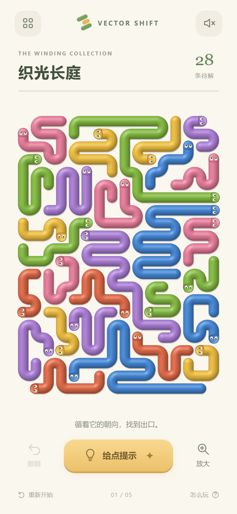

# Vector Shift｜绮彩长蛇

现在的 `index.html` 是**可玩的密盘重做版**：连续圆管、彩色长蛇、原创交错回折、完整心形和叶形棋盘。原来的 52 关保存在独立的 `phase.html`，从图案集可进入相位挑战。

[直接试玩](index.html) · [试玩 ZIP](delivery/Vector_Shift_playtest.zip) · [实录视频](artifacts/dense-playthrough.webm) · [重做与验收记录](docs/10_密盘重做与验证.md)



## 这次实际改了什么

- 首屏换成 16×22、28 条蛇的完整密盘；不是放大材质小样，也不是旧八根管子缩细。
- 五张可解棋盘共 128 条蛇：两张纵向密盘、心形、叶形、八条蛇的入门盘。四张密盘填充率约 94%～95%，没有纯直蛇；相邻蛇使用不同皮肤色。
- 移除格砖和大三角头，使用连续圆角、圆尾、统一曲面光照、小眼睛头部；颜色帮助追踪身份。
- 身体沿原路径逐段滑出。阻挡时轻触反馈；连续点击、提示、撤销、刷新续玩、双指缩放和拖动均可用。
- 中文演示、英文渠道构建。声音可选、减弱动态可选；键盘可操作并有方向标签。

**当前是可供评审的重做版。** 静态尺度已接近主参考截图；是否整体达到或超过参考，继续以整盘画面和实际试玩判断。竞品实机、物理手机与玩家偏好尚未验证。

## 打开与操作

直接用浏览器打开 `index.html`，离线即可玩。也可在本目录运行 `python src/serve.py`，打开打印出的本地地址。

点头部或身体：前方畅通时，小蛇离开；受阻时先释放挡路的蛇。没有生命惩罚，也不需要看广告使用提示。放大后可拖动，手机支持双指缩放。`Z` 撤销、`H` 提示；画布上方向键选择，Enter / 空格放行。

左上角打开图案集，选择五张棋盘；底部进入相位挑战。相位挑战保留原有 52 关、每日题与存档，设置菜单可返回新图案集。**新密盘没有相位切换，六色只是皮肤色。**

## 项目文件

| 文件 | 用途 |
| --- | --- |
| `src/dense-core.js` | 独立移除规则、几何验证、依赖求解、严格存档验证；不依赖渲染 |
| `src/dense-app.js`、`dense.css`、`dense.template.html` | 新首页的 Canvas 材质、路径动画、触摸与界面 |
| `src/dense-levels.py`、`data/dense-levels.json` | 固定种子原创密盘生成、逐层依赖、完整见证及身体跟随回放 |
| `src/game-core.js`、`app.js`、`styles.css`、`data/levels.json` | 原相位挑战代码与 52 关数据 |
| `src/build.py` | 生成演示与两渠道的 `index.html` / `phase.html` |
| `src/build_dense_evidence.py` | 从真实截图复测五个管身样本并生成同宽三方对照 |
| `tests/dense-core.test.cjs`、`dense-smoke.cjs`、`dense-capture.cjs` | 新规则测试、真实输入检查、连续实录和阶段图 |
| `tests/core.test.cjs`、`smoke.cjs` | 原相位挑战回归 |
| `docs/10_密盘重做与验证.md` | 当前实施裁决、测量、修复记录和未验证项 |
| `docs/09_对标重新对齐与密盘标准.md` | 重做前的静态诊断和 ALIGN 标准，作为历史基准保留 |
| `artifacts/dense-*` | 本次真实浏览器截图、视频、像素测量及报告 |
| `submission/` | 英文渠道候选；未投稿、未获平台批准 |

## 重建与复验

```powershell
node tests/dense-core.test.cjs
python src/dense-levels.py --verify
node tests/core.test.cjs
python src/build.py
```

浏览器检查需要 Playwright 与 Chromium，可通过 `PLAYWRIGHT_MODULE` 和 `CHROMIUM_PATH` 指定本机安装：

```powershell
node tests/dense-smoke.cjs
node tests/smoke.cjs
python src/build_dense_evidence.py  # 需要 Pillow
# 本地服务开启后，录制默认动画与四个清盘阶段
node tests/dense-capture.cjs
python src/package_delivery.py
```

密盘检查通过六个视口、五关 128 次真实头部/身体点选、受阻与提示、连续点选、续玩与撤销、触摸缩放/平移、异常存档恢复，以及两种英文渠道。CrazyGames SDK 生命周期使用本地 mock 检查，不代表平台审核。

原始技术候选 `delivery/Vector_Shift_v02_prelaunch_candidate.zip` 只作历史追溯；不要将它当作当前版。参考产品的源码、素材与具体关卡未嵌入游戏。
