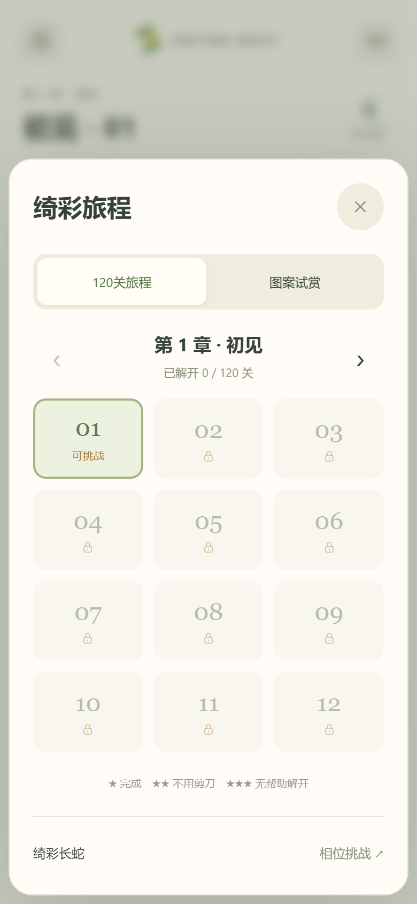

# Vector Shift｜绮彩长蛇

当前主入口是 **120关、10章旅程**，累计3,268条蛇。首章从4～10条教学，后期棋盘最多56条；每章两道缓和关。五张原评审棋盘保留在图案试赏，原52关相位挑战通过独立的 `phase.html` 保留。

[直接试玩](index.html) · [离线试玩包](delivery/Vector_Shift_playtest.zip) · [旅程实录](artifacts/campaign/journey-playthrough.webm) · [施工与验收](docs/12_量产关卡与技能施工.md)

渠道候选：[Coolmath](delivery/Vector_Shift_coolmath_candidate.zip) · [CrazyGames](delivery/Vector_Shift_crazygames-basic_candidate.zip) · [交付哈希清单](delivery/RELEASE_MANIFEST.json)。均未投稿。



## 本版完成内容

- 120张原创、不重复、无技能也可解的棋盘；旋转/镜像/头尾归一化去重，独立重算几何、依赖和身体跟随。浏览器内直接加载离线数据。
- 逐关解锁、10章选择、自动续玩、最佳星级。每章按观察工作量递进，缓和关指标严格低于前一关；玩家难度仍待校准。
- 剪刀从第6关开放，每局一次。选蛇并确认后原地消除，撤销返还技能；减少动态、重试、刷新和异常存档均有恢复规则。没有付费或广告依赖。
- 正常放行保持严格阻挡：跨越轮廓空白检查后方身体，尾巴完全离场后才解除占位；相交运动路径等待，无关路径可并行。
- 连续圆管材质和圆角爬行，运动纹理按需缓存；换盘时主动释放Canvas位图。中文演示与两个英文候选构建，声音/减少动态/键盘及方向标签保留。
- 五张密盘试赏与原52关模式独立存档。旧版图案存档继续恢复在原模式。

**当前为离线发行候选。** 真实玩家难度、物理手机与平台审核尚未完成，不能把自动测试视作上线批准。

## 打开与操作

离线打开 `index.html`，或运行 `python src/serve.py`，使用打印的本地地址。左上角菜单切换旅程与图案试赏。点头或身体放行；`Z`撤销、`H`提示，方向键选择后Enter/空格放行。支持双指缩放、放大后拖动，棋盘右下角可切换缩放。

第6关起，每局有一次剪刀：点击剪刀、选择蛇、确认；可取消且取消不消耗。完成得1星，不用剪刀得2星，不用剪刀/提示且无受阻误点得3星。最佳成绩不会被重玩降级。新模式六色只作身份区分，没有相位切换。

## 项目文件

| 文件 | 用途 |
| --- | --- |
| `src/dense-core.js` | 独立移除规则、几何验证、依赖求解、严格存档验证；不依赖渲染 |
| `src/dense-motion.js` | 按路程爬行、柔和起步、完整尾部离场、运动路径预约 |
| `src/dense-app.js`、`dense.css`、`dense.template.html` | 新首页的 Canvas 材质、路径动画、触摸与界面 |
| `src/campaign-levels.py`、`data/campaign-levels.json` | 120关产线、去重、难度排序与独立审计 |
| `src/dense-levels.py`、`data/dense-levels.json` | 固定种子原创密盘生成、逐层依赖、完整见证及身体跟随回放 |
| `src/game-core.js`、`app.js`、`styles.css`、`data/levels.json` | 原相位挑战代码与 52 关数据 |
| `src/build.py` | 生成演示与两渠道的 `index.html` / `phase.html` |
| `docs/12_量产关卡与技能施工.md` | 120关施工合同、技能规范、难度节奏、验收与发行缺口 |
| `src/build_dense_evidence.py` | 从真实截图复测五个管身样本并生成同宽三方对照 |
| `tests/dense-core.test.cjs`、`dense-motion.test.cjs` | 完整射线、存档、可解性、连续运动与碰撞单元测试 |
| `tests/dense-smoke.cjs`、`dense-collision-smoke.cjs`、`dense-capture.cjs` | 真实输入、运动中并发/撤销、默认动效五关通关、连续实录和阶段图 |
| `tests/campaign.test.cjs`、`campaign-smoke.cjs` | 全旅程、技能历史、解锁/评分/存档、真实点选与默认运动 |
| `tests/campaign-capture.cjs`、`release-audit.cjs` | 真实动效录像与候选构建审计 |
| `tests/core.test.cjs`、`smoke.cjs` | 原相位挑战回归 |
| `docs/10_密盘重做与验证.md` | 当前实施裁决、测量、修复记录和未验证项 |
| `docs/11_碰撞与爬行动效修复.md` | 凹口漏判、移动中穿越的修复与动效验收 |
| `docs/09_对标重新对齐与密盘标准.md` | 重做前的静态诊断和 ALIGN 标准，作为历史基准保留 |
| `artifacts/dense-*` | 本次真实浏览器截图、视频、像素测量及报告 |
| `artifacts/campaign/` | 120关回放报告、章节/关卡截图、技能实录与渠道构建哈希 |
| `artifacts/mobile/` | 八种移动视口、触摸章节/帮助流程的截图和自动化报告 |
| `submission/` | 英文渠道候选；未投稿、未获平台批准 |

## 重建与复验

```powershell
node tests/dense-core.test.cjs
node tests/dense-motion.test.cjs
node tests/campaign.test.cjs
python src/dense-levels.py --verify
python src/campaign-levels.py --verify
node tests/core.test.cjs
python src/build.py
```

浏览器检查需要 Playwright 与 Chromium，可通过 `PLAYWRIGHT_MODULE` 和 `CHROMIUM_PATH` 指定本机安装：

```powershell
node tests/dense-smoke.cjs
node tests/dense-collision-smoke.cjs
node tests/campaign-smoke.cjs
node tests/release-audit.cjs
node tests/mobile-layout.cjs
node tests/smoke.cjs
python src/build_dense_evidence.py  # 需要 Pillow
# 本地服务开启后，录制默认动画与四个清盘阶段
node tests/dense-capture.cjs
node tests/campaign-capture.cjs
python src/package_delivery.py
```

旅程36项规则/运动/技能测试通过；120关/3,268条蛇全部在浏览器真实点选通关（减少动态），第12/60/108/120关另外完成默认动效通关。构建会先重算120关几何、解、去重和排序指标，失败则停止导出。

密盘检查通过六个视口、五关128次真实头部/身体点选、受阻与提示、连续点选、续玩与撤销、触摸缩放/平移、异常存档恢复，以及两种英文渠道。CrazyGames SDK生命周期使用本地mock检查，不代表平台审核。

原始技术候选 `delivery/Vector_Shift_v02_prelaunch_candidate.zip` 只作历史追溯；不要将它当作当前版。参考产品的源码、素材与具体关卡未嵌入游戏。
