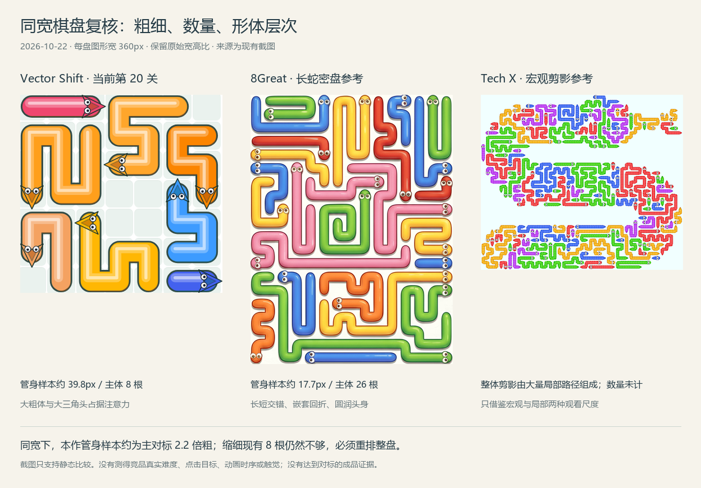

# Vector Shift 对标重新对齐与密盘标准 V1.1

日期：2026-10-22。裁决：**尚未完成产品对齐；静态差距已重新测量，制作目标已修订。**

本文件补正 [V1 规范](08_产品设计与验收规范.md) 中对粗细、数量、整盘复杂度约束不够，以及过早把新增机关放入主线的问题。涉及冲突时，本补充优先。仍处于设计阶段，不是游戏已经达到竞品水平的证明。

## 1. 上一轮缺了什么

V1 已识别颜色语义、单调移除和动画缺陷，也提出了形状家族；但没有把当前棋盘与主对标按相同宽度直接比较。两根管子的材质样板、六个空剪影，都没有回答“实际整盘是否仍然粗、少、简单”。

还有两处需要纠正：

- `0.64～0.72 格` 只控制管身相对格子的比例。棋盘横向只有七八格时，管身依然显得极粗。必须同时约束**管身 / 整盘可见宽度**。
- 合法移除单调，并不等于同类玩法没有丰富度或只能做幼稚关卡。路径追踪、头尾配对、跨区阻挡、逐层释放本身就能构成观察解谜。上一轮不应让“继电出口”抢在同类基础品质对齐之前。

## 2. 对标角色明确，不混成另一种产品

| 参考 | 本轮对齐什么 | 不从它推断什么 |
| --- | --- | --- |
| **8Great Snake Arrows Puzzles Escape**，既有 `snake_arrows_ios_ss2.png` | 主对标：彩色长蛇的相对粗细、独立主体量、长短交错、圆管与头部体积、整盘丰富度 | 真实关卡难度、动画毫秒、热区、震动；均未实测。 |
| **Tech X Snake Arrow : Puzzle Escape**，既有 `snake_arrow_ss1.png` | 次对标：大量局部路径共同组成宏观形体，近看路径、远看剪影 | 不把宣传画面当实际首屏，不凭这张图声称数量或关卡节奏已测得。 |
| **AppBurst Arrow Out**，既有 `arrow_out_ss1.png` | 次对标：心形轮廓、边界与负空间 | 其细线稿不是本作彩色软管的材质目标；不把三种产品美术随意拼接。 |

来源入口用于追溯：[8Great App Store](https://apps.apple.com/us/app/snake-arrows-puzzles-escape/id6757818523)、[Tech X Google Play](https://play.google.com/store/apps/details?id=com.snake.arrow.puzzle.game)、[AppBurst Google Play](https://play.google.com/store/apps/details?id=com.appburst.arrowout)。本轮观察对象是已保存的截图，**没有重新实机玩过这些产品，也没有复核商店当前版本**。

## 3. 同宽测量与可复核证据

方法：只裁可见谜题主体，去掉外部 UI、宣传大字和大块留白，横向统一为 360px，保持原始宽高比。取直段上垂直于身体的三个样本，含实体暗边、不含投影、头部或转弯。抗锯齿边界允许约 ±2 原图像素误差，因此数值应近似阅读。

| 观察项 | 本作当前 L20 | 8Great 这张参考图 | 结论 |
| --- | --- | --- | --- |
| 可见主体包围盒 | 353×346 原图像素 | 754×1005 原图像素 | 参考是较高的密盘；不能把它压扁成方盘比较。 |
| 独立主体 | **8**，由关卡数据和完整截图核对 | **26**，逐头人工编号 | 主体数量与组织方式存在实质差距。 |
| 直段宽度三个样本 | 39 / 39 / 39 原图像素 | 37 / 37 / 39 原图像素 | 原始截图分辨率不同，不能直接说粗细接近。 |
| 管宽 / 可见整盘宽 | 约 **11.0%** | 约 **4.9～5.2%** | 本作相对管宽约为参考的 2.2 倍。 |
| 整盘 360px 宽时管宽 | 约 **39.8px** | 约 **17.7～18.6px** | 改动必须落到棋盘尺度，而不只是颜色与阴影。 |
| 内部编排 | 少量粗大路径、显眼格砖、大三角头 | 更多独立路径，长短回折嵌套，圆润头身与整体轮廓相互协调 | 需要重排整盘。把原来的八根缩细会制造空洞。 |

尺寸为静态可见像素，**不是点击热区尺寸，也不是竞品逻辑网格**。26 是这一张参考图的人工计数，不代表竞品全部关卡。两盘面积和高宽比不同，本表不是严格控制面积的认知难度实验。

证据文件：

- [参考图：26 个头与三个测量位置](../artifacts/benchmark-alignment/8great-dense-annotated.png)
- [本作：8 个头与三个测量位置](../artifacts/benchmark-alignment/vs-level20-annotated.png)
- [原图坐标与裁切定义](benchmark-measurements.json)
- [计算结果和源图 SHA-256](../artifacts/benchmark-alignment/measurements.json)
- [复现脚本](../src/build_benchmark_alignment.py)：项目目录运行 `python src/build_benchmark_alignment.py`，需要 Pillow 和中文字体。人工选定样本不是自动全图分割，不冒充所有管身的均值。

## 4. 新增密盘验收要求

以下是**本作下一轮首张普通密盘的制作目标**，参考上述证据制定，尚未在成品上测得。不套给初学教学关，也不强迫所有形状同样密集。

| ID | 标准 | 如何验收 |
| --- | --- | --- |
| ALIGN-01 管宽尺度 | 可见管身含暗边占整盘可见宽 **4.5%～6%**；整盘 360px 时约 **16～22px**。与管宽/格距约束同时满足。 | 对实际初始棋盘取至少 5 个直段样本，报中位数和范围；不得拿独立放大的材质样条代测。 |
| ALIGN-02 主体规模 | 首张密盘 **24～32 个独立主体**；长、中、短均有明确角色。不得用少量超长体刷填充率。 | 数据计数 + 头部标注图；同看长/中/短长度分布与实际画面。数量达到不自动算美观通过。 |
| ALIGN-03 回折编排 | 首张候选至少 8 条路径有 ≥3 次转向，其中至少 4 条有 ≥5 次转向；长体组织主走势、中体编织、短体提供间隔与释放。 | 由有序格路径计算转向，忽略圆角采样产生的小角度；附路径编号图，人工确认不是重复 U 形铺满。该数量是制作起点，不是竞品精确统计。 |
| ALIGN-04 中尺度结构 | 同时能读出至少三个相邻编排区；有长体跨越编排区，不能只是三个互不关联的小谜题拼在一起。 | 设计卡画出分区与跨区阻挡关系；提供逐层释放的阶段图。每区必须有原因，不能只在图上画三条分隔线。 |
| ALIGN-05 舞台比例 | 普通纵向密盘先试高/宽 **1.15～1.4**；手机初始视图能看全轮廓，主操作仍可达。 | 在真实屏幕尺寸验收。不要让所有布局服从同一个正方形容器。具体异形保留其合理宽高比。 |
| ALIGN-06 主体质感 | 头身连贯，圆润转折，侧面明暗与高光连续；主体之间有窄而清楚的缝，格砖与粗暗轮廓不抢主角。 | 同宽全盘、局部放大、灰度图三种尺度对照。不能靠泛白、降饱和、加空白把彩色长蛇做成另一种极简产品。 |
| ALIGN-07 形体完整 | 心形、叶形等首批关必须有**完整填入路径的棋盘**；轮廓与内部节奏同时成立。 | 空剪影仅作为前置草图，不再计为“造型样板完成”。与密盘使用同一材质/头型系统。 |
| ALIGN-08 手指可操作 | 可见身体可以细，但选择要稳定：就近命中规则、按下对象确认、放大、取消手势均明确。 | 真实手机按意图记录错选、路径判断错误与手势冲突。禁止通过重叠 44px 热区制造表面达标，也不能一开局就要求放大才能认图。 |
| ALIGN-09 释放节奏 | 提交 100% / 约75% / 约50% / 约25% 剩余主体的状态图与连续录像；中途仍有结构变化与清理节奏。 | 标明选择的实际合法回放；静态宣传图无法证明此项。依赖层数、找路时间和连续操作分别记录。 |
| ALIGN-10 对照对象 | 每次评审同时放“当前版 / 新候选 / 主对标”，保持谜题可见宽度一致，保留原比例。 | 新候选必须是可解的实际关卡渲染；拼图、素材图、仅换色的八根管子不算。 |

目前全部 ALIGN 项目是目标，**没有成品通过记录**。现有引擎的边长 12、精确 solver 23 主体上限，已经小于首张密盘目标；这是需要解决的工程阻断，不能悄悄把设计目标降回旧版 8 根。

## 5. 材质与颜色不能只由一张小样冻结

保留 V1 的“类别必须可读、不能语义乱色”原则。但把“蓝金双系 + 半哑光瓷面”作为**候选 A**，不能把上一轮两根管子的展示直接当成已对齐风格。

首张真实密盘做同几何的两个静态候选：

- A：蓝/金两类稳定色系，类内受控明度差异、清楚分缝与类别标记。
- B：4～6 种受控主体色用于追踪身份，以稳定头后环/扣和按下预览表达可旋转/固定；若采用 B，游戏文案也必须同步改成按标记区分类别，不能继续写“所有蓝色转、金色固定”。

二者都追求饱满、圆润、连续的长蛇，不复制竞品具体头型和调色布局。比较的是**真实密盘的追踪清晰度、类别理解与整体吸引力**；没有同盘对照前，不永久冻结为两色，也不直接回到现版随机彩虹语义。候选 B 当前未实现，未被判优。

## 6. 难度优先补同类基本功

第一轮保持现有规则，先改善：

1. **路径追踪**：需要看清长路径、找到头尾、判断相邻体，保证信息足够清楚而非故意隐藏。
2. **阻挡结构**：从局部释放到跨区解锁，用多轮闭包和相位变化形成节奏；仍然如实承认合法移除不会破坏可解性。
3. **整盘进展**：每次移除产生可见空间变化，清盘过程中从密到疏有连续的视觉与操作回报。
4. **难度曲线**：教学只教一个规律；普通关按查找量与依赖组织递进；密盘与舒缓关交替。关号、填充率、主体数不能单独当难度。

这是与现有箭头/长蛇品类直接相关的丰富度。不能因为我们证明了当前规则的单调性，就声称竞品一定有非单调机关，或声称没有坏分支便不值得制作。

“继电出口”维持 **HYPOTHESIS**，移到基础对标样板之后；不再是第一轮三张棋盘通过的前提。只有基础体验合格、试玩仍明确需要更多顺序策略，才做独立四关试验。它不计入“已经对齐竞品”的成绩。

## 7. 修订后的顺序与状态

| 阶段 | 必须交付 | 当前 |
| --- | --- | --- |
| A 静态诊断 | 同宽对照、头部计数、管宽采样、来源坐标、制作边界 | 本轮已完成；只证明差距。 |
| B 单张普通密盘 | 24～32 主体的原创可解关卡，16～22px 相对管宽目标、完整编排；同几何材质 A/B | 未完成。先解决规模与验证方案。 |
| C 两张异形盘 | 心形、叶形实际填入路径，两相位、同宽对照、整体与局部层次均通过 | 未完成。 |
| D 连续操作 | 按压、受阻、滑出、相位、连续点选；真机与中间帧证据 | 未完成。上一轮 HTML 说明模型不替代。 |
| E 基础对标评审 | 静态只做静态结论；取得竞品实机后再比较实际玩法与手感 | 未完成；不得写“已达到/超过”。 |
| F 策略扩展 | 视基础试玩需求决定是否试继电出口 | HYPOTHESIS / DEFERRED。 |

本次逆向审计：**BLOCKER**＝现有规模与验证能力达不到普通密盘目标；**MAJOR**＝尚无完整新棋盘、密盘材质选择未冻结、竞品实机与真机操作证据缺失；**MINOR**＝具体阴影/高光数值仍需随密盘调优。没有忽略这些问题进入“量产完成”。

当前准确表述：**已经重新明确静态对标差距和验收目标；游戏尚未完成重新对齐。**
