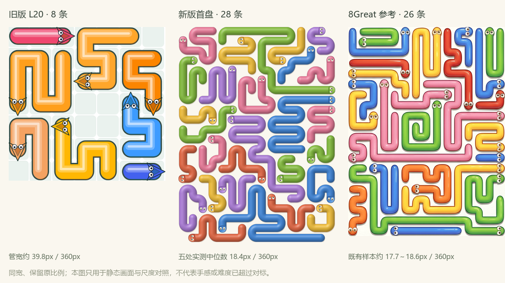

# 可玩密盘重做与验证

日期：2026-10-22。**实际实现已交付，供视觉与试玩评审。** 当前主入口是五张新密盘，原52关通过独立相位入口保留。这里记录实现与证据；不把内部技术通过写成竞品超越或玩家偏好结论。

## 直接看结果

- [可玩主入口](../index.html)、[离线试玩包](../delivery/Vector_Shift_playtest.zip)
- [同宽三方对照](../artifacts/dense-same-width-comparison.png)：旧版、新版、已保存的8Great参考，保留各自比例。
- [首盘](../artifacts/dense-pattern-1.png)、[心形](../artifacts/dense-pattern-2.png)、[叶形](../artifacts/dense-pattern-3.png)、[大密盘](../artifacts/dense-pattern-4.png)
- [真实浏览器点击实录](../artifacts/dense-playthrough.webm)：默认动画，完整首盘、心形前段与叶形选择。不是生成视频或静态拼接。

## 与旧版相比，落地了哪些变化

| 项目 | 旧版 L20 | 当前新首页 |
| --- | --- | --- |
| 主体数量 | 8 | 28 |
| 360px整盘宽时管宽 | 旧样本约39.8px | 五处实测中位18.38px，范围18.38～18.92px |
| 构图 | 小网格、粗管、明显格砖 | 16×22纵向满盘、长短交织、无格砖 |
| 材质 | 多条高光带、大三角头 | 连续曲面明暗、真圆弧转角、圆尾、小眼睛头部 |
| 完整变体 | 原小尺度异形 | 完整心形、叶形、大纵盘与入门盘，共128主体 |
| 释放 | 旧版沿统一方向位移 | 身体沿自身中心线前进，按路径长度退出 |
| 点选 | 原SVG路径 | Canvas最近路径命中、按下确认、手势取消；不使用互相重叠的44px蛇热区 |

测量来自实际390×844截图，DPR=2；先限定Canvas区域，再取彩色主体包围盒，选五种皮肤的直段作垂直像素切线。含实体边缘、不含分离投影，抗锯齿阈值会带来小误差。详见[源图哈希/样本坐标](../artifacts/dense-width-measurements.json)、[标注图](../artifacts/dense-width-samples.png)、[复现脚本](../src/build_dense_evidence.py)。参考图17.7～18.6px沿用既有静态测量，未宣称重新实机核查。

## 关卡、形状和难度的实际组织

| 图案 | 尺寸 | 蛇数 | 填充率 | ≥3次转向 / ≥5次转向 | 初始可走数 | 依赖层数 |
| --- | --- | --- | --- | --- | --- | --- |
| 织光长庭 | 16×22 | 28 | 94.54% | 28 / 19 | 7 | 10 |
| 心间回环 | 22×22 | 32 | 94.84% | 32 / 17 | 9 | 8 |
| 叶脉之舞 | 22×22 | 28 | 94.70% | 27 / 11 | 10 | 12 |
| 流彩花园 | 18×24 | 32 | 94.39% | 32 / 28 | 7 | 11 |
| 初遇回环 | 8×8 | 8 | 98.33% | 8 / 3 | 4 | 4 |

这是图案评审集，默认展示密盘，入门盘可从图案集选择；尚未把五关排列声称为已验证的难度曲线。

首盘短体10条（2～8格）、中体14条（9～17格）、长体4条（≥18格），最长26格。头向上/右/下/左分别6/7/7/8。7条路径跨越纵向三分区，20条依赖边跨区；上下区之间有实际相互释放关系。完整逐蛇信息、阻挡图、层次、可解见证与阶段状态保存在 `data/dense-levels.json` 的 `metrics`。

生成使用固定种子的路径交换和搜索。每关独立重算拓扑见证、48次合法随机顺序回放、身体跟随检查；同输入可重现。形状由完整路径组成，六种皮肤用于追踪身份，相邻路径无同皮肤接触。

**规则仍为单调观察解谜**：合法移除不会使可解盘变成死局。增加主体、回折、跨区依赖和释放层数用于增加观察与追踪量；不宣称有坏分支或已证明更难。继电出口维持HYPOTHESIS / DEFERRED。

## 动作与点击验收

触下立即确认对象；移动超过8 CSS px取消点击，放大后转为拖动；双指围绕手指中点缩放，松开不会误放蛇。2026-10-22补修：尾巴完全离场后才提交移除，凹口后的障碍照常阻挡；运动路径相交时等待，不相交时可并行。静态主体和运动管身材质缓存，头尾沿路径连续前进；减弱动态可用。详见[碰撞与爬行动效修复](11_碰撞与爬行动效修复.md)。

相位挑战与新密盘分开：新密盘无相位按钮，颜色只是身份皮肤；相位挑战保留原蓝/金语义。这一实施选择取代V1.1提出的“同盘两种相位材质A/B”步骤，**没有伪造A/B玩家测试**。不把六色随机赋值后继续写成“所有蓝色旋转”。

释放阶段：[28条](../artifacts/dense-release-28.png)、[21条](../artifacts/dense-release-21.png)、[14条](../artifacts/dense-release-14.png)、[7条](../artifacts/dense-release-7.png)。[实际操作见证](../artifacts/dense-release-witness.json)记录录像中的顺序；它与生成器存储的另一条合法见证可能不同。

## 自动验证与独立复核

- `node tests/dense-core.test.cjs`：28项，通过（初版24项，补修增加凹口/自体阻挡等回归）；含48长蛇、4096主体、循环依赖、四向阻挡、不可变撤销、伪造历史拒绝、100个小盘与穷举比对、全部密盘见证。
- `node tests/dense-motion.test.cjs`：4项；按路程运动、四向完整离场、交叉轨迹预约、全部128条路径连续采样。
- `node tests/dense-collision-smoke.cjs`：真实输入复现凹口/运动中阻挡、并行/撤销/刷新/减弱动态切换；默认动效下五关128次点击全部通关。
- `python src/dense-levels.py --verify`：五关全部通过；重算几何、指标、拓扑与身体跟随。
- `node tests/dense-smoke.cjs`：五关128次真实头部/身体点选；390×844、360×800、412×915、320×568、844×390、1440×1000；手势、刷新、异常存档、两种英文构建与SDK mock。
- `node tests/core.test.cjs`、`node tests/smoke.cjs`：原52关及相位、每日题、旧存档等回归通过。
- `node tests/dense-capture.cjs`：真实默认动画录像与四个剩余比例阶段图。

[浏览器报告](../artifacts/dense-browser-report.json)只代表本机Chromium与触摸模拟。另单独检查568×320、667×375与844×390横屏：提示不换行、控件可达、无页面溢出。没有物理设备性能结论。

独立审查发现并修复：异形出口过早裁掉未离开的尾部、异常存档无限数字、右键误操作、非中心捏合漂移、字符串ID朗读错误；另修复拖动后首次按钮点击丢失。审查者针对五项复验全部关闭，服务页面代码与源代码一致。完整[初审](../artifacts/independent-review/REVIEW.md)与[闭合记录](../artifacts/independent-review/CLOSURE.md)保留，初审中的未关闭描述是修复前快照。

## 当前裁决与下一步

旧“主体规模无法支持密盘”的BLOCKER已关闭。真实密盘、两张异形、同宽对照与连续操作证据已交付。ALIGN-01/02/03/05/07/09/10已有实现或测量；ALIGN-04/06仍包含人工构图/质感判断，ALIGN-08仍缺物理手机意图误触率。

后续直接在这些实盘上评审：整盘吸引力、头尾辨识、长路径追踪、实际点按和释放节奏。竞品实机、真实玩家查找时间/误触/偏好、正式难度曲线、平台审核及商业结果均UNKNOWN。当前不写“已经超过参考”，也不再把已实现内容列成一张待开发计划。
