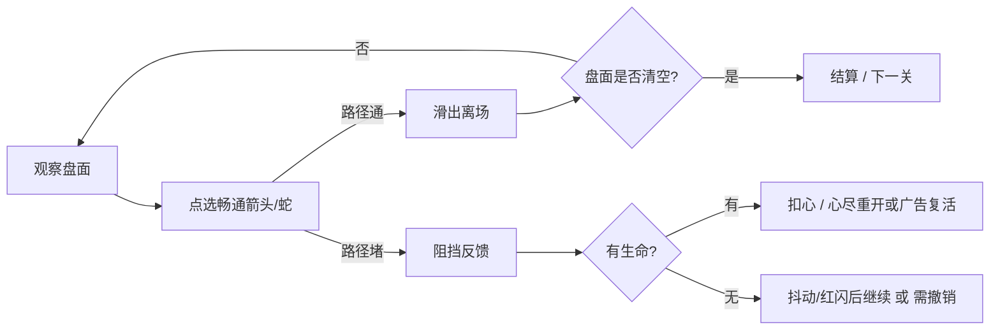
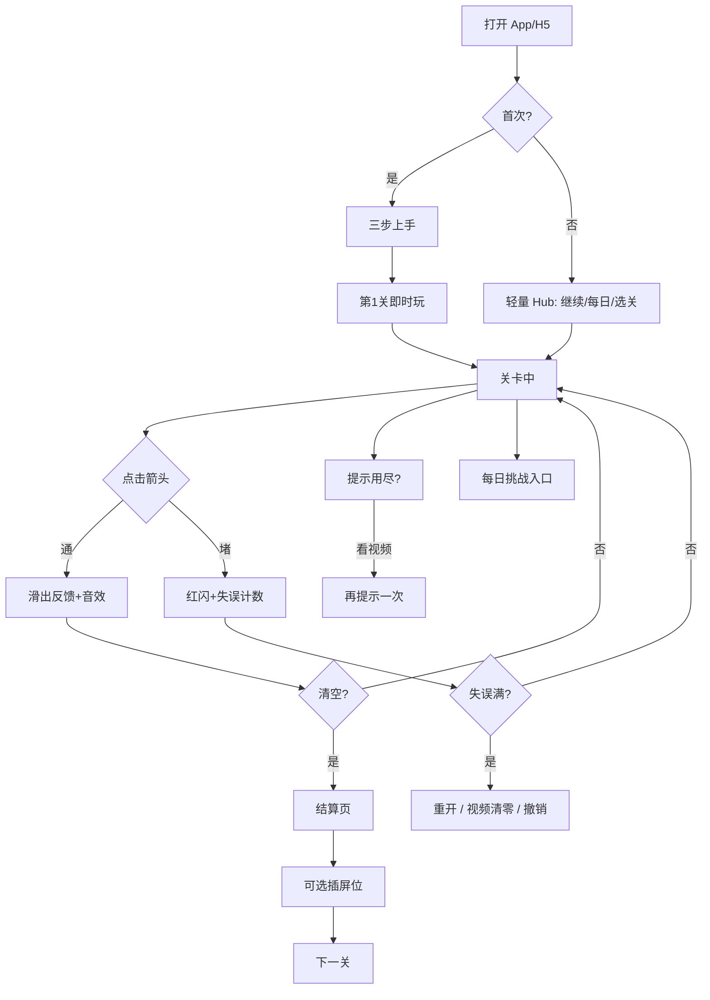

# 竞品产品流程对照｜Snake-Arrow / Arrow-Escape 品类

> 面向 Hazel / Vector Shift 竞品研究  
> 调研日期：2026-10-21（Asia/Shanghai）  
> 证据来源：Google Play / App Store 商店描述与评论、APKPure、第三方攻略/百科页、官网文案。  
> **未实机游玩**：无浏览器内操作；凡未在公开文案/评论中出现的节点一律标「未证实」。  
> Vector Shift 对照基准：仓库 v0.6 dense（`index.html` / `src/app.js` / `docs/01_机制与对标边界.md` / `README.md`）。

---

## 0. 品类共性核心循环（所有产品共享）



原子规则：**箭头/蛇有固定朝向；只有到边界的路径无其它未清除单位时才能离场；顺序是谜题本身。**

---

## 1. 产品档案（至少覆盖目标清单）

| # | 产品 | 厂商 | 包名 / ID | 量级（商店公开） | 备注 |
|---|---|---|---|---|---|
| 1 | **Snake Arrow : Puzzle Escape** | Tech X Solution | `com.snake.arrow.puzzle.game` | 50K+ 下载；约 4.6–4.7★ | 目标「蛇形箭头」直对标 |
| 2 | **Snake Arrows Puzzles Escape** | 8Great Games, LLC | iOS `id6757818523`；Android `com.eightgreatgames.snakearrowsescapepuzzleout` | iOS ~150+ 评分 4.6★；Android 10K+ | App Store 蛇箭头标题 |
| 3 | **Arrows Puzzle Escape Go**（商店曾用名 Arrows Puzzle Snake Escape） | 应鑫 李 | iOS `id6757147943` | 评分不足展示 | 蛇皮肤/宝石主题变体 |
| 4 | **Arrow Puzzle: Tap Puzzle Games** | Easybrain | `com.easybrain.arrow.puzzle.game` | **50M+**；~4.8★ / 1.5M+ 评价 | 品类头部「短箭头」 |
| 5 | **Arrows – Puzzle Escape** | Lessmore GmbH | iOS `id6748397500`；Android `com.ecffri.arrows` | iOS ~507K 评分 4.8★ | 品类头部「长箭头」 |
| 6 | **Amaze GO!™ - 箭头解谜**（曾用名 Arrows GO） | Oakever Games | `com.oakever.arrows` | **1亿+** 下载；4.8★ | 中文市场高热 |
| 7 | **Arrow Out Puzzle** | PIXEL KING PTE. LTD. | `arrow.out.puzzle.escape.logicpuzzle` | 500K+；4.8★ | Arrow Out 系 |
| 8 | **Tap Escape: Logic Puzzle** | NeoGame Global Ltd | `com.neo.arrows.escape.arrowout.puzzle.game` | 1M+；4.6★ | Tap / Arrow Out 系 |
| 9 | **Arrow Game（网页）** | arrowgame.app | 浏览器站 | 未证实下载量 | 中文文案完整，道具化典型 |
| 10 | 微信小游戏：**箭头解谜** / **机智的箭头** / **挪出那只箭** | 多为腾讯生态收录 | 应用宝 `wx56c993…` 等 | 量级未在公开页给出可靠数字 | 流程细节大多「未证实」 |

另：Tech X 同厂还有 **Arrow Unravel : Escape Puzzle**（`com.techxsolution.ArrowsWoolPuzzle`），商店描述含 Hint / Scissor / Ruler 工具——与蛇箭头同厂但非同一产品，下文仅作工具设计参考。

---

## 2. 分产品流程文档（A–H）

### 2.1 Snake Arrow : Puzzle Escape（Tech X Solution）

**证据主源**：[Play 商店](https://play.google.com/store/apps/details?id=com.snake.arrow.puzzle.game)、[APKPure](https://apkpure.net/snake-arrow-puzzle-escape/com.snake.arrow.puzzle.game)、Play 评论摘要。

#### A. 首次打开 / 新手引导
- 商店未描述开屏权限弹窗顺序 → **未证实**。
- 玩法以「点蛇滑出」为卖点；是否有强制教程关 → **未证实**（描述强调 simple one-tap，暗示低门槛）。
- 首次成功条件：清空迷宫中全部蛇（商店描述）。

#### B. 核心一局循环
1. 进入关卡（手作递进关卡，商店描述）
2. 观察蛇形箭头固定方向
3. 点可移动蛇 → 沿箭头方向滑出
4. 错误顺序会挡住整盘（描述）；**商店官方写「No penalties」**
5. 全部释放 → 过关

```
选关 → 观察 → 点蛇滑出 →（堵则反馈，罚则见 E）→ 清空 → 结算
```

#### C. 关卡推进
- 「Handcrafted Progressive Levels」从易到难（商店描述）
- 是否线性地图 / 星级 / 章节锁 → **未证实**

#### D. 卡住时
- **Hint**：自动清掉一只「正确」的蛇（商店描述）
- **Visualizer**：高亮蛇方向以辅助规划（商店描述）
- **Zoom**：放大检查 / 缩小看全图（商店描述）
- 撤销 / 重开按钮是否存在 → **未证实**

#### E. 失败或误操作
- **官方**：「No timers. No penalties.」（商店描述）
- **评论冲突**：有玩家抱怨误点丢 life、多点才移动（Play 评论 Phill, Jul 2026；开发者回复承认需改进）。以评论为准可认为**部分版本/状态存在生命扣减**，与商店文案不一致 → 标注「商店称无惩罚；评论称有生命」。

#### F. 变现
- Contains ads + IAP（Play 页）
- PlayStore Radar 类第三方曾列 IAP 约 $0.99–$26.99（第三方汇总，非官方细项）
- 激励视频具体出现时机 → **未证实**
- 评论强烈吐槽广告过多（同上 Phill 评论）

#### G. 设置 / 每日 / 活动
- **未证实**

#### H. 视觉与操作反馈
- 平滑滑出动画、柔和网格、Minimal UI（商店描述）
- 彩色可爱蛇（评论 aja walker）
- 路径预览色、音效有无 → **未证实**（Visualizer 暗示有方向高亮）

---

### 2.2 Snake Arrows Puzzles Escape（8Great）

**证据主源**：[App Store](https://apps.apple.com/us/app/snake-arrows-puzzles-escape/id6757818523)、PlayStore Radar Android 条目。

#### A. 首次打开 / 新手引导
- 商店未写教程步骤 → **未证实**
- 描述强调「Easy to understand but tricky to master」

#### B. 核心一局循环
- 蛇形箭头；路径全通才可逃脱；错误顺序会「stop your escape」；清空网格过关（商店描述）
- No timers / No rush（商店描述）

#### C. 关卡推进
- 「Carefully handcrafted levels that increase in difficulty gradually」
- 版本历史多次「New levels」→ 持续加关
- 地图/星级 → **未证实**

#### D. 卡住时
- 「Helpful hints available when you are truly stuck」（商店描述）
- 提示是否看广告 / 耗金币 → 有 Coins IAP（见 F），具体绑定 **未证实**

#### E. 失败或误操作
- 商店未写生命/罚时 → **未证实**（仅「one wrong move can stop your escape」）

#### F. 变现（有证据）
- Contains Advertising（年龄分级说明）
- IAP 公开列表含：Coins 多档、$7.99 No Ads、Keep Up Offer、Ultra/Medium Bundle、Open Piggy Bank 等（App Store IAP 列表）
- 礼包出现时机（首次第几关弹）→ **未证实**

#### G. 设置 / 每日 / 活动
- Offline play supported（商店描述）
- 每日挑战 → **未证实**

#### H. 视觉与操作反馈
- Clean visuals；路径/箭头易读（商店描述）
- 滑出动效 / 音效 → **未证实**

---

### 2.3 Arrows Puzzle Escape Go / Snake Escape（应鑫 李）

**证据主源**：[App Store](https://apps.apple.com/us/app/arrows-puzzle-snake-escape/id6757147943)

#### A–B
- 点任意蛇/箭，沿指向射出直到撞墙或其它箭；清出方格；勿互挡（商店描述）
- 无时间限制（商店描述）
- 教程流程 → **未证实**

#### C
- 「Thousands of meticulously designed levels」递进难度
- 解锁主题 / Cute Snake Skins / jewel-style（商店描述）→ **收集/换皮** 是差异点

#### D–E
- 提示 / 生命 → **未证实**
- 无时间限制已证实

#### F
- Contains Advertising；商店未列 IAP 细项 → 广告有；IAP **未证实**

#### G–H
- 多彩主题、蛇皮肤收集（商店描述）
- 其它 → **未证实**

---

### 2.4 Easybrain Arrow Puzzle（品类头部｜短箭头）

**证据主源**：[Play](https://play.google.com/store/apps/details?id=com.easybrain.arrow.puzzle.game)、[App Store](https://apps.apple.com/us/app/arrow-puzzle-tap-away-game/id6755482314)、[Easybrain Help：去广告](https://arrowpuzzleios.easybrain.com/hc/en-us/articles/10198084343450-How-do-I-remove-ads)、[广告问题说明](https://arrowpuzzleios.easybrain.com/hc/en-us/articles/10796433733274-Having-issues-with-ads)、[dailygamestoplay 玩法页](https://dailygamestoplay.com/games/arrow-puzzle-easybrain)

#### A. 首次打开 / 新手引导
- 公开页未逐步披露开屏流程 → **未证实**
- 规则在商店「How to Play」写清：通路径才可点；误点扣生命

#### B. 核心一局循环
1. 网格满布不同方向箭头（可直可弯，第三方玩法页）
2. 找畅通路径 → 点选滑出
3. 误点受阻 → **扣一条生命**
4. 清空 → 过关

#### C. 关卡推进
- Hundreds of handcrafted levels，难度递增（商店）
- UI 有剩余箭头计数、难度标签（dailygamestoplay）
- 线性/地图具体形态 → **未证实**（评论提到数百关进度）

#### D. 卡住时
- Hint：高亮一只可安全离开的箭头（商店 + 玩法页）
- 是否可撤销单步 → **未证实**（可 rethink and try again，偏重开）

#### E. 失败或误操作
- **有生命**，每关有限；评论与开发者回复多次确认误触丢心（Play / App Store 评论）
- dailygamestoplay：**三颗心**
- **无计时器**（商店）
- 心尽后流程（广告复活 / 纯重开）→ Help 未写死；**部分未证实**

#### F. 变现（证据充分）
- 关间广告、功能广告（Help：「between games, after finishing levels, or when using certain features」）
- **Remove Ads** 一次性购买；入口：`Me` → Remove Ads（Help）
- 去广告后**可选激励广告**仍可出现（可跳过）
- IAP：Coin packs、No Ads 多价、Starter/Safety/Classic/Epic Bundle 等（App Store）
- 评论：大量吐槽广告密度；亦有「买去广告后体验大好」

#### G. 设置 / 每日 / 活动
- **Daily Challenges**：每日一题；月度挑战收集奖杯（商店）
- Play 页可见 Events & offers（锦标赛/奖牌文案）
- Me / Settings 区存在（Help 路径）

#### H. 视觉与操作反馈
- 极简抽象图形风、顺滑动画（商店）
- App Store 评论提到 **haptic**（箭头飞出震动）
- 触控误触问题被大量抱怨（评论摘要）
- 路径预览色：商店未写恒显预览 → **未证实**（Hint 会高亮）

---

### 2.5 Lessmore｜Arrows – Puzzle Escape（品类头部｜长箭头）

**证据主源**：[App Store](https://apps.apple.com/us/app/arrows-puzzle-escape/id6748397500)、[KashKick 攻略](https://kashkick.com/guide/game-tips/arrows-puzzle-escape-tips/)、用户长评。

#### A. 首次打开 / 新手引导
- 评论：「When you first download it, games start simple and become progressively more complex」（Rodsaturkey, Jun 2025/2026 窗口）
- 强制教程 UI 逐步说明 → **未证实**

#### B. 核心一局循环
1. 点箭头 → 沿方向飞出盘外（攻略）
2. 路径不全通则失败：路线闪红 + 扣心（攻略）
3. 清空全部箭头过关
4. 商店 slogan：「Can you clear the grid without losing a single heart?」

#### C. 关卡推进
- Thousands of handcrafted levels（商店）
- 前期线性递进；后期复杂度到达后「下一关随机化」（用户评论）
- **Daily / 月度 Trophy**（App Store Events：October Trophy — complete every daily puzzle, keep streak）
- 难度标签：hard / very hard / …（用户评论）

#### D. 卡住时
- Hint 按钮指向安全步（商店 + 攻略 + 评论）
- 金币可买额外心与 boosters（攻略）
- 提示/道具耗尽后：金币或广告补充（攻略）
- 重开关卡可用（攻略 FAQ）

#### E. 失败或误操作
- **每关 3 心**；用尽需重开（多源一致：商店暗示 + 攻略 + 评论）
- 评论：心尽后「watch an ad」即可继续（Rodsaturkey）——激励复活有证据
- **无计时器、无步数上限**（商店 + 攻略）

#### F. 变现（证据充分）
- 广告（评论大量提及；Contains Advertising）
- IAP：Remove Ads（$9.99 等）、订阅制去广告、Buy Hints、Refill Global Lives、Streak Freezers/Fixer 等（App Store IAP 列表）
- 礼包弹出时机 → **未证实**

#### G. 设置 / 每日 / 活动
- Daily puzzles + streak + monthly trophy（Events）
- Dark mode toggle 曾在版本说明中出现（Version History）
- Game Center 支持（App Store Supports）

#### H. 视觉与操作反馈
- 点阵网格辅助对齐行列（评论 + 攻略）
- 阻挡时路径闪红（攻略）
- 长箭头「蛇状」扫过多格（攻略）
- 缩放/平移：评论抱怨大盘需拖动、捏合不够（UI 反馈语言的痛点）
- 音效 → **未证实**

---

### 2.6 Amaze GO!™ - 箭头解谜（Oakever｜中文市场爆款）

**证据主源**：[Play 中文页](https://play.google.com/store/apps/details?hl=zh_CN&id=com.oakever.arrows)、英文同包名页、评论摘要。

#### A. 首次打开 / 新手引导
- 商店未逐步披露 → **未证实**
- 强调「快速上手」

#### B. 核心一局循环
1. 找通向边缘的自由路径箭头
2. 点击滑出，为下一步开路
3. **长按**启用「指导」功能，路径不清时高亮方向（中文商店）
4. 错误点击消耗一颗心
5. 清空棋盘；争取「完美通关」（商店）

#### C. 关卡推进
- 大量关卡、离线可玩（商店）
- 地图/星级具体规则 → **未证实**（「完美通关」暗示有评价维度）

#### D. 卡住时
- **长按指导**（方向高亮）
- **提示**功能（商店）
- 撤销 → **未证实**

#### E. 失败或误操作
- **有心（生命）**；错误点击耗心（商店）
- 无强制计时描述（偏「平静」）
- 心尽后续 → **未证实**

#### F. 变现
- 包含广告；评论投诉「每一关都有广告、超长」（中文评论）
- IAP 细项商店页未完整列出 → **未证实细项**（含广告已证实）

#### G. 设置 / 每日 / 活动
- **未证实**（商店主推离线安静体验）

#### H. 视觉与操作反馈
- 简洁界面；箭头飞离有舒适「嗖」声（商店明确写音效）
- 清晰路径反馈（商店）
- 曾有「尾部相连自动连锁消除」功能被更新移除（中文评论）

---

### 2.7 Arrow Out Puzzle（PIXEL KING）

**证据主源**：[Play](https://play.google.com/store/apps/details?id=arrow.out.puzzle.escape.logicpuzzle)、评论 Kat Ryan。

#### A–B
- Tap and slide arrows along designated paths；错误会互相撞击（商店）
- 教程细节 → **未证实**

#### C
- Hundreds of handcrafted levels；难度标签 hard / veryhard / …（评论）
- 评论提到 **Timed levels** 存在（Kat Ryan）——与多数「无计时」竞品不同

#### D
- 提示系统 → **未证实**（商店未强调）

#### E
- 撞击/阻挡惩罚机制有；生命数值 → **未证实**
- 有限时关（评论）

#### F
- Contains ads + IAP
- 评论：$8 Remove Ads（标 50% off）；约前 20 关后出现广告；约每 2–3 关一广告；杀进程规避会加重（Kat Ryan）——**广告节奏有评论证据**

#### G–H
- 干净视觉、流体动画（商店）
- 箭头偏细、误触难（评论）

---

### 2.8 Tap Escape: Logic Puzzle（NeoGame）

**证据主源**：[Play](https://play.google.com/store/apps/details?id=com.neo.arrows.escape.arrowout.puzzle.game)

#### A–B
- 彩色箭头固定方向；观察颜色/位置/顺序；一错可能整策略重来（商店）
- 教程 → **未证实**

#### C
- Multiple logic levels；难度变化
- 评论抱怨后期重复同一谜题 → 内容循环风险

#### D
- Smart hint system（商店）
- Light/dark mode（商店）

#### E
- 「wrong move… restarted」→ 偏重开而非生命；是否有心 → **未证实**

#### F
- Contains ads + IAP；细节 **未证实**

#### G–H
- 明暗模式；彩色区分；其它反馈 → **未证实**

---

### 2.9 Arrow Game 网页版（arrowgame.app｜中文流程最完整公开站）

**证据主源**：[中文官网](https://arrowgame.app/zh/)

> 注意：这是浏览器产品，不是 App Store 蛇箭头，但公开文案把「箭头逃脱」商业化流程写得最全，对 Vector Shift Web/H5 渠道极有参考价值。

#### A. 首次打开
- **无注册、无下载、页面加载即第 1 关**（官网）
- 左上角 `?` 打开游戏指南（官网）
- 无冗长菜单（官网）

#### B. 核心一局
- 通路径点击离场；误点扣红心；清空过关
- 连击：连续安全点击提高金币奖励
- 离场箭头可能掉落礼物（提示 / 不可阻挡之箭等）

#### C. 关卡推进
- 主线宣称 **1,000 关**；前期教学图形 → 后期密集
- 红心耗尽可提交本轮最高关到排行榜

#### D. 卡住时
- **提示**：自动释放一支合法箭
- **不可阻挡之箭**：下一击摧毁路径阻挡
- **护盾**：抵消一次受阻点击
- **双指缩放 + 拖动**（移动端）

#### E. 失败
- 有红心；耗尽结束本轮（可上榜）
- 无强制倒计时描述

#### F. 变现
- 官网主推免费在线；金币/商店买道具、技能升级（道具经济）
- 传统激励视频/去广告 → **未证实**（网页模式可能不同）

#### G
- **每日首领挑战**
- 排行榜
- 技能升级（幸运四叶草、大惊喜、连击收益等）

#### H
- 造型关（新月/蝴蝶/沙漏/雪花等图形盘）
- 截图展示密集路线；反馈语言以红心/连击/礼物为主

---

### 2.10 中国市场微信小游戏（箭头解谜 / 机智的箭头 / 挪出那只箭）

**证据主源**：[应用宝-箭头解谜](https://sj.qq.com/appdetail/wx56c9934194edc9f4)、[应用宝-机智的箭头](https://sj.qq.com/appdetail/wx86fc3b8ea01d0659)、[7k7k-挪出那只箭](https://www.7k7k.com/wxgame/16335.htm)、行业稿提及「拔箭头」赛道（36氪等，本次抓取超时，仅作品类存在旁证）。

| 节点 | 结论 |
|---|---|
| 核心玩法 | 应用宝简介：「点击不同方向的箭头寻找走出迷宫的路径」；「停不下来的箭头消除」 |
| A 首次引导 | **未证实**（微信登录即玩是生态默认，非产品文档） |
| B–E 生命/提示/广告 | **未证实**（无可靠商店长文） |
| F 变现 | 微信小游戏通常含激励视频/分享，但本调研**不能**据此断言这三款的具体节点 |
| 对 Vector Shift 的启示 | 国内「拔箭头」已成明确赛道名；上架文案应覆盖「箭头逃脱 / 连体箭头 / 箭头滑出」关键词，但流程细节需实机或更完整素材再补 |

---

## 3. 总对照表（行 = 流程节点，列 = 产品）

图例：✅ 有（公开证据）｜⚠️ 部分/冲突｜❌ 无或明确否定｜❓ 未证实

缩写：  
SA = Snake Arrow (Tech X)｜8G = 8Great Snake Arrows｜APS = Arrows Puzzle Escape Go｜EB = Easybrain｜LM = Lessmore｜AGO = Amaze GO｜AO = Arrow Out｜TE = Tap Escape｜WEB = arrowgame.app｜VS = Vector Shift v0.6

| 流程节点 | SA | 8G | APS | EB | LM | AGO | AO | TE | WEB | VS v0.6 |
|---|---|---|---|---|---|---|---|---|---|---|
| 开屏即进第 1 关 / 低菜单摩擦 | ❓ | ❓ | ❓ | ❓ | ⚠️评论称由易入难 | ❓ | ❓ | ❓ | ✅ | ✅（打开即局） |
| 分步新手引导卡 | ❓ | ❓ | ❓ | ❓ | ❓ | ❓ | ❓ | ❓ | ✅指南`?` | ✅三步 onboard |
| 相位/特殊机制教学 | ❌品类无 | ❌ | ❌ | ❌ | ❌ | ❌ | ❌ | ❌ | ❌ | ✅ L3 phase coach |
| 点选滑出核心循环 | ✅ | ✅ | ✅ | ✅ | ✅ | ✅ | ✅ | ✅ | ✅ | ✅ |
| 路径预览（悬停/按下绿红） | ❓ | ❓ | ❓ | ❓ | ⚠️阻挡闪红 | ✅长按指导 | ❓ | ❓ | ❓ | ✅ exit ray 绿/红 |
| 阻挡反馈（抖/闪） | ⚠️ | ❓ | ❓ | ✅丢心 | ✅闪红+丢心 | ✅丢心 | ✅撞击 | ⚠️重开语义 | ✅丢心 | ✅ hit/blocked 无扣心 |
| 生命 / 红心 | ⚠️商店否/评论有 | ❓ | ❓ | ✅≈3 | ✅3 | ✅ | ❓ | ❓ | ✅ | ❌无生命 |
| 无计时（主循环） | ✅官方 | ✅ | ✅ | ✅ | ✅ | ✅偏平静 | ⚠️有限时关评论 | ❓ | ✅ | ✅ |
| 撤销 Undo | ❓ | ❓ | ❓ | ❓ | ❓ | ❓ | ❓ | ❓ | ❓ | ✅ |
| 重开 Retry | ❓ | ❓ | ❓ | ✅可重来 | ✅ | ❓ | ❓ | ✅语义 | ❓ | ✅ |
| Hint 提示 | ✅清一只正确蛇 | ✅ | ❓ | ✅高亮安全箭 | ✅ | ✅ | ❓ | ✅ | ✅自动释放 | ✅一步最短解提示 |
| 方向 Visualizer / 指导 | ✅ | ❓ | ❓ | ❓ | 点阵网格 | ✅长按 | ❓ | ❓ | ❓ | ⚠️射线预览≈弱可视化 |
| 缩放 Zoom / 平移 | ✅ | ❓ | ❓ | ⚠️评论抱怨屏动 | ⚠️评论需拖动 | ❓ | ❓ | ❓ | ✅双指缩放 | ❌ |
| 线性/递进关卡 | ✅手作递进 | ✅ | ✅千关 | ✅数百+ | ✅千关级 | ✅ | ✅数百 | ✅ | ✅1000 | ✅52 关解锁 |
| 星级 / 完美通关评价 | ❓ | ❓ | ❓ | ❓ | ⚠️无心通关口号 | ✅完美通关文案 | ⚠️难度标签 | ❓ | ❓ | ⚠️最短解差距非星 |
| 每日挑战 | ❓ | ❓ | ❓ | ✅+月奖杯 | ✅+streak/trophy | ❓ | ❓ | ❓ | ✅每日首领 | ✅本地日期种子 |
| 激励视频复活/补心 | ❓ | ❓ | ❓ | ⚠️可选激励 | ✅评论看广告继续 | ❓ | ❓ | ❓ | ❓ | ❌ |
| 关间插屏广告 | ✅含广告+评论 | ✅含广告 | ✅含广告 | ✅Help确认 | ✅ | ✅评论 | ✅评论节奏 | ✅含广告 | ❓ | ❌ |
| 去广告 IAP | ❓有IAP | ✅$7.99 | ❓ | ✅ | ✅多档/订阅 | ❓ | ✅~$8评论 | ❓ | ❓ | ❌ |
| 金币 / 礼包 / Piggy | ❓ | ✅ | ⚠️皮肤收集 | ✅ | ✅ | ❓ | ❓ | ❓ | ✅金币技能 | ❌ |
| 设置（音效/主题） | ❓ | ❓ | ❓ | ✅Me区 | ✅含暗色 | ❓ | ❓ | ✅明暗 | ❓ | ✅音效/安静提示/最短解 |
| 滑出动效 | ✅商店 | ✅「satisfying」 | ✅ | ✅ | ✅ | ✅+嗖声 | ✅ | ✅ | ✅ | ✅ slide-off |
| 触感 Haptic | ❓ | ❓ | ❓ | ✅评论 | ❓ | ❓ | ❓ | ❓ | ❓ | ❌ |
| 排行榜 / 活动赛 | ❓ | ❓ | ❓ | ✅Events | ✅Game Center | ❓ | ❓ | ❓ | ✅ | ❌ |

---

## 4. Vector Shift v0.6 已有流程（对照基准）

来源：`src/app.js`、`src/index.template.html`、`docs/01_机制与对标边界.md`、`README.md`（**代码/文档证据，非商店**）。

| 节点 | Vector Shift 现状 |
|---|---|
| A 首次 | 打开即开局；三步 onboard；L3 相位 coach；提示 coach |
| B 一局 | 观察 → 悬停/按下显示绿红出口射线 → 点击滑出 → 阻挡抖动/红闪（**不扣心**）→ 清空 |
| C 推进 | 52 关；菜单格子解锁；本地 best；通关显示与最短解差距 |
| D 卡住 | 撤销 / 重开 / 提示（最短解一步，含「先切相位」） |
| E 失败 | **无生命、无倒计时**；死局文案引导撤销/重开；连续阻挡有 soft guidance |
| F 变现 | **无广告、无 IAP**（文档明确未实现） |
| G | 设置（音效、安静提示、通关后显示最短解、清进度）；每日挑战（本地日期种子，非运营） |
| H | 多格蛇身、糖果色、滑出粒子、WebAudio；无 haptic；无双指缩放 |
| USP | **蓝色相位群旋转**（竞品表中独家） |

---

## 5. Vector Shift 缺口清单（相对头部商业流程）

按「上架转化 / 留存」相关度排序，不是按炫技。

| # | 缺口 | 头部怎么做 | VS 现状 | 转化影响 |
|---|---|---|---|---|
| 1 | **关间结算节奏 + 广告/去广告漏斗** | EB/LM/AO：过关→插屏→下一关；显眼 Remove Ads | 无结算商业层 | 免费渠道上架后的主要 ARPU 来源缺失 |
| 2 | **卡住时的「有代价提示」** | Hint 绑金币或激励视频；LM/EB 明确 | Hint 免费无限（本地） | 早期可免费，但缺「看广告换提示」这个高转化钩子 |
| 3 | **误操作成本语言（生命或等价）** | 3 心 + 闪红；广告补心 | 仅视觉惩罚 | 品类玩家已形成「点心」心智；过松会显得「不是同款游戏」，过紧需配撤销 |
| 4 | **每日挑战的运营外壳** | 月奖杯、streak、补签 IAP | 有本地每日，无 streak/奖杯/回访文案 | D1/D7 回访弱 |
| 5 | **密集盘缩放/全览** | SA 主打 Zoom；LM/EB 玩家抱怨缺好缩放 | 无 zoom/pan | 后期关卡误触↑、差评风险↑ |
| 6 | **独立方向 Visualizer** | SA Visualizer；AGO 长按指导 | 仅悬停射线 | 「教会玩家看路」的工具感不足 |
| 7 | **Home Hub（选关/每日/商店入口）** | EB Me + Daily；多数 App 有底栏 | 偏「永远在玩」；齿轮菜单较弱 | 商店截图与留存入口不完整 |
| 8 | **首次会话权限/ATT/登录墙处理** | 商业 App 必有 | H5 无 | 进商店包时需补，否则审核/首日流失 |
| 9 | **完美通关 / 星级 / 无伤** | LM「不丢心」；AGO「完美」 | 仅最短解差 | 缺重玩动机与分享话术 |
| 10 | **Haptic + 更强离场反馈** | EB 评论点名震动多巴胺 | 仅 WebAudio | 移动端「爽感」弱于头部 |
| 11 | **激励复活 / 全局生命池** | LM Refill Global Lives、看广告继续 | 无 | 变现第二曲线 |
| 12 | **中文市场关键词与换皮收集** | APS 蛇皮肤；AGO 中文爆款名 | 有中文 UI，无收集成长 | 国内素材/商店 ASO 弱 |
| — | 相位 USP | 竞品无 | **已有** | 保持差异，勿被生命/广告稀释教学 |

---

## 6. 建议优先补的 5 个流程（按上架转化）

> 原则：先让商店用户在 60 秒内感到「这就是箭头逃脱」，再让卡住与过关两处产生自然付费/广告点；相位 USP 延后到第 3 关再教（VS 已做对）。

### ① 过关结算页 +「下一关」主按钮（可挂插屏位）
- **为何优先**：所有头部都把「爽感峰值」放在清空瞬间；VS 有最短解文案，但缺商业结算壳。
- **最小实现**：清空 → 大号「漂亮/通关」→ 步数与最短差 → **下一关**；预留 `ad_slot_interstitial`（即使 demo 渠道不播）。
- **证据对齐**：EB Help（关后广告）；AO 评论（关间广告节奏）。

### ② 「提示」改为有限次数 + 激励视频补一次（demo 可只做次数 UI）
- **为何优先**：卡关是付费/广告最高意愿点；免费无限提示会毁掉后续变现，也会让关卡显得无压力。
- **最小实现**：每关 1 次免费提示 → 用尽后「看视频再提示」按钮（Web 渠道可灰显并写「商店版」）。
- **证据对齐**：SA Hint；EB/LM Hint；WEB 提示道具。

### ③ 阻挡反馈升级为「可选生命模式」或「失误计数徽章」
- **为何优先**：品类心智是「点心」；完全无代价会被当成 demo。但 VS 有撤销，不宜照搬虐心。
- **最小实现（转化友好）**：默认 **3 次失误徽章**（非强制失败）；耗尽弹出「重开 / 看视频清零失误 / 用撤销」三选一。保留无生命的「禅模式」在设置里。
- **证据对齐**：EB/LM/AGO 生命；SA 商店「无惩罚」vs 评论有生命 → 说明市场两边都有，**可设置切换**是差异化安全牌。

### ④ 每日挑战外壳：日期、streak、一句话回访
- **为何优先**：VS 已有本地每日种子，差的是「为什么明天还要打开」。
- **最小实现**：每日页显示连续天数；断签不惩罚（或 streak freezer 以后再做）；通关盖章「今日已完成」。
- **证据对齐**：EB 月奖杯；LM October Trophy + streak。

### ⑤ 盘面缩放 + 长按/按钮「显示全部方向」
- **为何优先**：蛇身多格 + 后期高填充（v0.6 dense）最容易误触差评；SA/AGO 已把可视化当卖点写进商店。
- **最小实现**：双指缩放或 +/-；工具栏「方向」开关一次性描出所有朝向（等同 SA Visualizer / AGO 长按指导）。
- **证据对齐**：SA Zoom+Visualizer；AGO 长按；LM/EB 误触差评。

---

## 7. 给 Vector Shift 的流程示意（建议态，非现状）



---

## 8. 方法局限（诚实边界）

1. **无实机**：未安装 APK/IPA，未点进关卡；截图仅能从商店缩略推断，故大量 UI 细节标「未证实」。
2. **商店文案 ≠ 真实 build**：SA「No penalties」与评论「lose a life」冲突，以双源并陈。
3. **微信小游戏**公开信息过少，不可编造激励视频节点。
4. **第三方攻略**（KashKick、dailygamestoplay）可能滞后于版本，已与商店交叉核对核心规则。
5. Vector Shift 对照基于仓库文件，若发行包裁剪功能，以实际包为准。

---

## 9. 主要来源 URL

- https://play.google.com/store/apps/details?id=com.snake.arrow.puzzle.game  
- https://apkpure.net/snake-arrow-puzzle-escape/com.snake.arrow.puzzle.game  
- https://apps.apple.com/us/app/snake-arrows-puzzles-escape/id6757818523  
- https://apps.apple.com/us/app/arrows-puzzle-snake-escape/id6757147943  
- https://play.google.com/store/apps/details?id=com.easybrain.arrow.puzzle.game  
- https://apps.apple.com/us/app/arrow-puzzle-tap-away-game/id6755482314  
- https://arrowpuzzleios.easybrain.com/hc/en-us/articles/10796433733274-Having-issues-with-ads  
- https://arrowpuzzleios.easybrain.com/hc/en-us/articles/10198084343450-How-do-I-remove-ads  
- https://dailygamestoplay.com/games/arrow-puzzle-easybrain  
- https://apps.apple.com/us/app/arrows-puzzle-escape/id6748397500  
- https://kashkick.com/guide/game-tips/arrows-puzzle-escape-tips/  
- https://play.google.com/store/apps/details?hl=zh_CN&id=com.oakever.arrows  
- https://play.google.com/store/apps/details?id=arrow.out.puzzle.escape.logicpuzzle  
- https://play.google.com/store/apps/details?id=com.neo.arrows.escape.arrowout.puzzle.game  
- https://arrowgame.app/zh/  
- https://sj.qq.com/appdetail/wx56c9934194edc9f4  

---

*文档结束｜Vector Shift 竞品流程对照 v1*

---

## 10. 商店截图实据补强（2026-10-21）

> 来源目录：`artifacts/competitors/`。Play 商店页在本机浏览器超时，截图为商店官方素材直链转 PNG；App Store `/us` 会跳 CN 店面。

### 从画面直接可见的 HUD / 流程（修正此前「未证实」项）

| 产品 | 局内顶栏 | 局内底栏 | 生命 | 提示 | 其它 |
|---|---|---|---|---|---|
| Snake Arrow (Tech X) | home / restart / **3 心** / **金币** | 未见缩放按钮（营销图） | **有 3 心**（与商店「No penalties」文案冲突，以截图为准） | 营销图未露 Hint 按钮 | ss3 有手势教程 + 绿色方向箭头 |
| Snake Arrows (8Great) | pause / undo / **3 心** / **Hint+** | **缩放 −/+**、关卡 `#` | **有 3 心** | Hint 带绿色 **+**（暗示广告/IAP 补） | 蛇身有「眼睛」、盘面极密、弯折复杂 |
| Arrow Out (AppBurst) | back / LEVEL / **3 心** | 极简 | **有 3 心**；挡住会弹回并空心 | 玩法图无 Hint 按钮；结算统计有 HINTS | **异形棋盘**（心形/树）；Daily 结算：**CLEARED** + streak「N days in a row」+ TIME/MISSES/HINTS + Share |
| 箭头-逃脱大师 (CN) | back / restart / 关卡格 / 设置；进度条 | Hint + Undo | **3 心** | 有 Hint | 关卡有主题名（Geometric Flow 等）；英文 HUD |

### 对 Vector Shift 的画面级结论（补充第 6 节）

1. **3 心是品类默认语言**——即便 Tech X 商店写无惩罚，营销图仍画三颗心。
2. **结算页要有「CLEARED / streak / 统计 / 分享」壳**——Arrow Out Daily 是完整范本。
3. **Hint 要带「+」补给感**；Zoom 是密集蛇盘标配（8Great 底栏明写）。
4. **棋盘造型可以异形**（心/树/雪花），不只是方格——后期差异化素材用。
5. 我们 v0.6 粗色块方向对了，但竞品蛇更「玩具化」（高光管状、眼睛、更弯的折线）。
